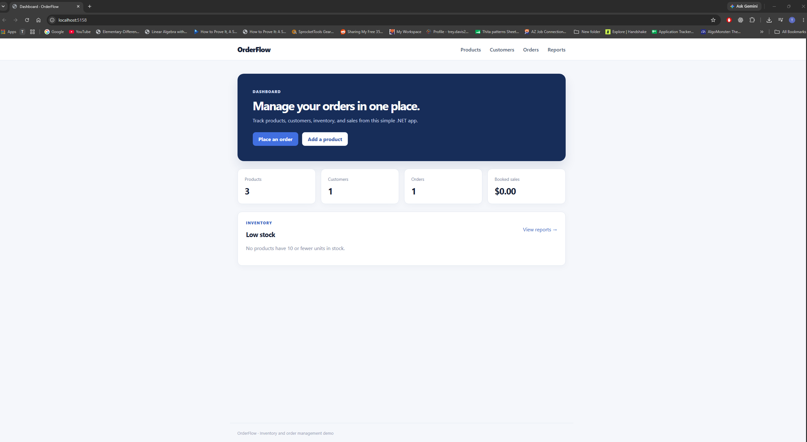
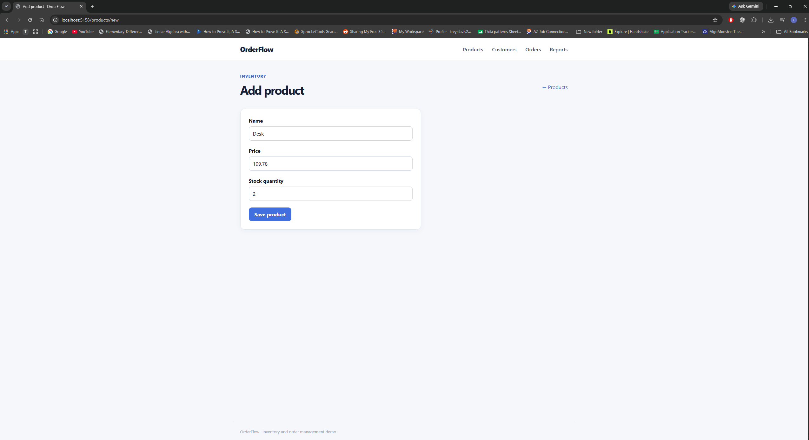
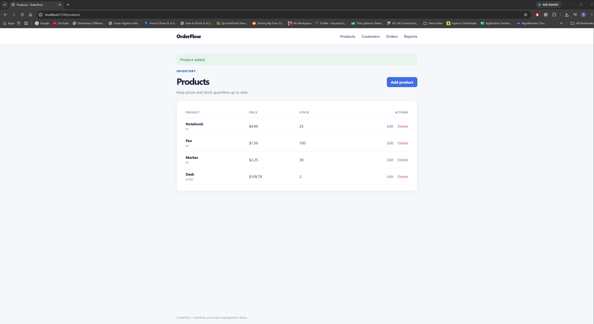
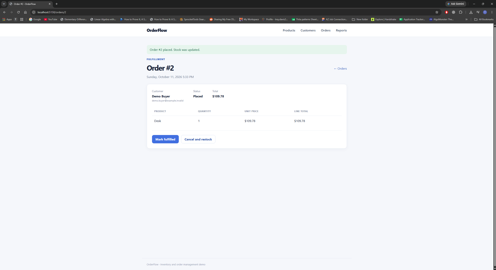
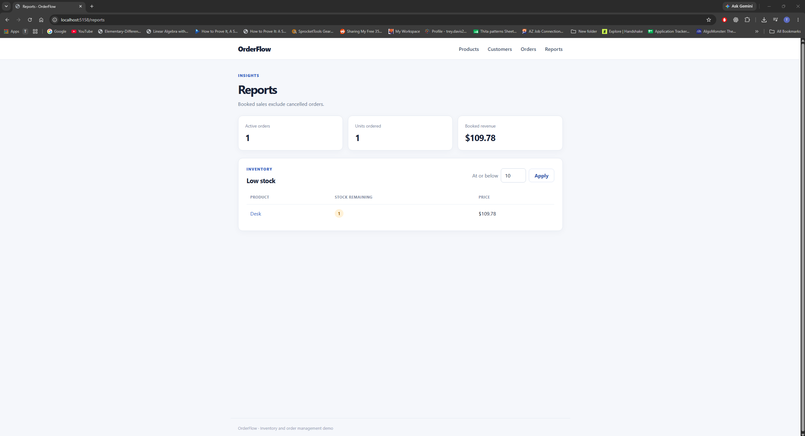

# OrderFlow

OrderFlow is a C# / ASP.NET Core web app and API for product inventory, customers, and orders. It uses SQL Server through Entity Framework Core and demonstrates transactional stock updates, optimistic concurrency, request validation, reporting, and database-backed integration tests. Docker Compose runs the app and database together for a local demo.



## Features

- Product create, read, update, and delete endpoints with price and stock validation.
- Customer creation and lookup with a unique email constraint.
- Order placement with one or more distinct products. The server snapshots each product's name and unit price on the order item.
- Inventory deduction and order creation in one database transaction. Missing products, insufficient stock, or a concurrent stock change prevent the order from being placed.
- Order status transitions from `Placed` to `Fulfilled` or `Cancelled`. Cancelling restores stock in a transaction; a final status cannot be changed again.
- Low-stock products and booked-sales summary endpoints. Booked revenue includes placed and fulfilled orders and excludes cancelled orders; this API does not process payments.
- OpenAPI JSON at `/openapi/v1.json` in Development.
- Browser pages for the dashboard, product and customer forms, single-product order placement, order status, and reports.

## Stack

.NET 10, ASP.NET Core MVC and API controllers, Razor views, EF Core 10, SQL Server LocalDB or containerized SQL Server 2022, xUnit, and Microsoft OpenAPI. The browser UI and JSON API share the same services. The API uses request and response DTOs so database entities do not define the public JSON contract.

## Run with Docker

Install Docker Desktop and select Linux containers. From the repository root, copy `.env.example` to `.env` and replace the sample password with a strong, unique password. In PowerShell:

```powershell
Copy-Item .env.example .env
# Edit .env and replace the sample password before starting the containers.
docker compose up --build -d
```

Open `http://localhost:5158/`. Compose runs the web app and SQL Server 2022 Developer Edition. The app waits for SQL Server, applies EF Core migrations, and inserts two starter products into a new database. Database files persist in the `sqlserver-data` Docker volume. This database is separate from the Windows LocalDB database used by Visual Studio. Stop the containers with `docker compose down`; use `docker compose down -v` only when you intend to delete the container database. Port `5158` must be free, so stop the Visual Studio run first.

## Run locally

Install the .NET 10 SDK and SQL Server LocalDB (available with Visual Studio on Windows). From the repository root:

```powershell
dotnet tool restore
dotnet restore OrderFlow.slnx
dotnet run --project src/OrderFlow.Api --launch-profile http
```

The development app applies EF Core migrations to the `OrderFlow` LocalDB database and inserts two starter products if the product table is empty. Open `http://localhost:5158/` for the dashboard. The browser pages are at `/products`, `/customers`, `/orders`, and `/reports`; JSON endpoints remain under `/api`. The connection string in `src/OrderFlow.Api/appsettings.json` can be overridden with `ConnectionStrings__OrderFlow`; keep credentials out of Git.

In Visual Studio, open `OrderFlow.slnx`, set `OrderFlow.Api` as the startup project, select the `http` profile, and press F5. The browser should open the dashboard. If the process exits before the page appears, check that SQL Server LocalDB starts successfully with `sqllocaldb start MSSQLLocalDB`.

Run the integration tests with:

```powershell
dotnet test OrderFlow.slnx
```

Tests create temporary `OrderFlowTest_<guid>` LocalDB databases, apply the migrations, and delete them afterward. They check order placement and cancellation, rejection without partial stock changes, and booked-sales exclusion of cancelled orders.

## Screenshots

| Dashboard | Add a product |
| --- | --- |
|  |  |

| Product inventory | Place an order |
| --- | --- |
|  |  |



## API

| Method | Route | Purpose |
| --- | --- | --- |
| GET / POST | `/api/products` | List or create products |
| GET / PUT / DELETE | `/api/products/{id}` | Read, update, or delete a product |
| GET / POST | `/api/customers` | List or create customers |
| GET | `/api/customers/{id}` | Read one customer |
| GET / POST | `/api/orders` | List or place orders |
| GET | `/api/orders/{id}` | Read an order |
| PATCH | `/api/orders/{id}/status` | Fulfill or cancel a placed order |
| GET | `/api/reports/low-stock?threshold=10` | Products at or below a stock threshold |
| GET | `/api/reports/sales` | Active order count, units, and booked revenue |

Example requests are in [`src/OrderFlow.Api/OrderFlow.Api.http`](src/OrderFlow.Api/OrderFlow.Api.http). Product creation returns 201 with a `Location` header. An order with insufficient stock returns 409 and does not change inventory. Invalid request bodies return 400 through ASP.NET Core model validation.

## Design choices

- SQL Server generates IDs. Product and order `rowversion` columns detect competing updates; EF Core returns a concurrency conflict instead of silently overwriting stock or status.
- The order service checks all items before changing stock, then saves the order and stock changes inside one transaction. The unique `(OrderId, ProductId)` index also protects the one-product-per-line rule.
- Order items keep a unit-price and name snapshot so later product edits do not change the recorded order total or item name.
- SQL check constraints reject negative inventory, nonpositive prices, and nonpositive order quantities even if data is written outside the API.

## Current limits

This is a portfolio demo. It has no authentication or payment processing and is intended for local use. The browser form places one product per order; the API supports multiple products. Local Visual Studio runs use SQL Server LocalDB on Windows; Docker Compose supplies a separate SQL Server container. The sales endpoint reports booked value, not completed payments. The development seed is intentionally small.
